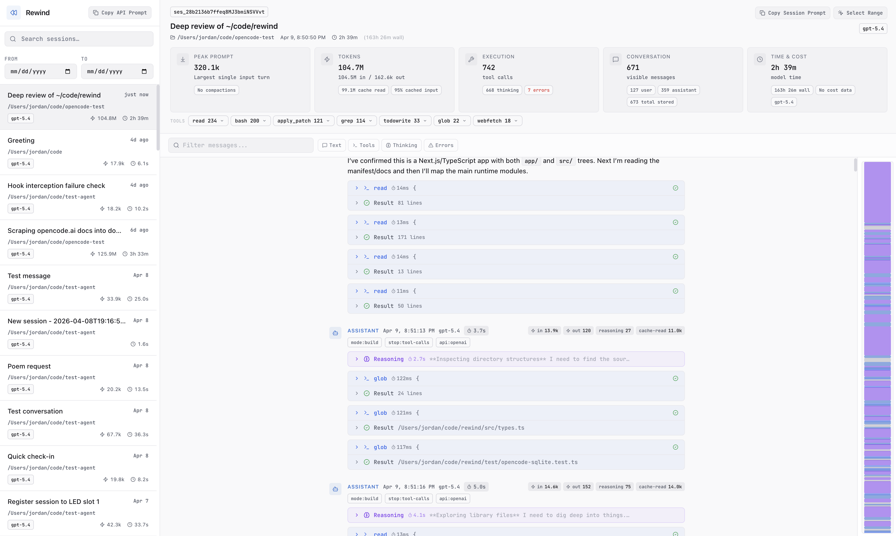

# rewind

Local viewer, analytics dashboard, and TypeScript library for inspecting OpenCode sessions.

Published on npm as `opencode-rewind`.

This project is not built by the OpenCode team and is not affiliated with OpenCode or Anomaly.



## Why

OpenCode stores rich local session state, but the raw SQLite data is awkward to inspect directly.
Both the OpenCode 1 and OpenCode 2 database layouts are supported.
Rewind turns it into something easier to use for:

- browsing sessions
- drilling into tool calls and subagents
- inspecting compactions, diffs, and todos
- understanding token usage, timing, and cost over time

## Usage Modes

`opencode-rewind` can be used in three different ways:

1. as an OpenCode plugin that powers `/rewind` and `/rewind-off`
2. as a standalone CLI/server you run yourself
3. as a TypeScript library

## OpenCode Plugin

`opencode-rewind` can also be loaded as an OpenCode plugin.

The package root is the plugin entry for OpenCode. The TypeScript library API lives at `opencode-rewind/lib`.

You do not need to install the package globally for the plugin workflow.
Add the plugin and commands to your OpenCode config, and OpenCode will install the npm package into its plugin cache automatically.

OpenCode plugins and slash commands are configured separately. The plugin handles `/rewind` and `/rewind-off` in the `command.execute.before` hook, but the commands still need to be defined in your OpenCode config so they appear in the TUI.

Add it to your OpenCode config:

```json
{
  "$schema": "https://opencode.ai/config.json",
  "plugin": ["opencode-rewind"],
  "command": {
    "rewind": {
      "description": "Open the current OpenCode session in Rewind",
      "template": "Handled locally by the Rewind plugin. No model response is needed."
    },
    "rewind-off": {
      "description": "Stop the managed Rewind server",
      "template": "Handled locally by the Rewind plugin. No model response is needed."
    }
  }
}
```

What the plugin does:

- `/rewind` ensures the Rewind server is running, then opens the current session in your browser
- `/rewind-off` stops the managed background Rewind server

The plugin tries to neutralize the command body before the normal model flow, but OpenCode may still record a lightweight command message in the transcript.

The npm plugin package includes the Rewind CLI internally, so `/rewind` and `/rewind-off` do not require a separate global install.

Optional plugin config:

```json
{
  "plugin": [["opencode-rewind", {
    "baseUrl": "http://127.0.0.1:3838",
    "rewindCommand": "rewind",
    "stopCommand": "rewind-off"
  }]]
}
```

`cliCommand` is only needed for advanced overrides. By default the plugin runs the bundled CLI that ships inside the npm package.

### Local Plugin Iteration

To test plugin changes without publishing to npm, you can sync your local build into OpenCode's cached plugin install:

```bash
pnpm sync:opencode-cache
```

That rebuilds the package and copies these files into OpenCode's cached package directory:

- `dist/`
- `bin/`
- `.next/`
- `package.json`
- `README.md`

Then restart OpenCode.

You can also smoke test the cached install directly:

```bash
pnpm smoke:opencode-cache
```

Both scripts default to:

```text
~/.cache/opencode/packages/opencode-rewind@latest/node_modules/opencode-rewind
```

Override the target with `OPENCODE_REWIND_CACHE_DIR` if needed.

## CLI

Install globally if you want to run the Rewind web app yourself outside OpenCode:

```bash
npm install -g opencode-rewind
opencode-rewind start
```

Optional flags:

```bash
opencode-rewind start --port 3838 --host 127.0.0.1
opencode-rewind stop
opencode-rewind status
```

`opencode-rewind` commands:

- `opencode-rewind` or `opencode-rewind serve` runs the app in the foreground
- `opencode-rewind start` starts it in the background if it is not already running
- `opencode-rewind stop` stops the managed background server
- `opencode-rewind status` reports whether the server is reachable

## Library

Install it in a JS/TS project if you want to consume the normalized OpenCode session API directly:

```bash
pnpm add opencode-rewind
```

```ts
 import { createRewind } from "opencode-rewind/lib";

const rewind = createRewind();

const sessions = await rewind.listSessions({ limit: 20 });
const session = await rewind.getSession(sessions[0].id);
const messages = await rewind.getMessages(sessions[0].id);

rewind.close();
```

### Config

```ts
 import { createRewind } from "opencode-rewind/lib";

const rewind = createRewind({
  basePath: "/custom/path/to/opencode-data-dir",
});
```

`basePath` should point at the OpenCode data directory.

By default Rewind reads:

- `~/.local/share/opencode/opencode.db`
- `~/.local/share/opencode/storage/session_diff/*.json`

If `XDG_DATA_HOME` is set, Rewind uses that base directory instead of `~/.local/share`.

### Direct Provider

If you want the OpenCode-specific provider directly:

```ts
 import { createOpenCodeProvider } from "opencode-rewind/providers/opencode";

const provider = createOpenCodeProvider();
const sessions = await provider.listSessions();
provider.close();
```

## API

### `createRewind(config?)`

Returns an object with:

- `listSessions(options?)`
- `getSession(sessionId)`
- `getMessages(sessionId)`
- `close()`

### `listSessions(options?)`

```ts
await rewind.listSessions({
  projectPath: "/Users/me/myproject",
  after: "2025-01-01T00:00:00Z",
  before: "2025-02-01T00:00:00Z",
  includeSubagents: true,
  limit: 50,
});
```

Subagent sessions are excluded by default. Pass `includeSubagents: true` to include them.

### `getSession(sessionId)`

Returns a normalized `Session` with:

- session summary fields
- `messages`
- `diffs` from `storage/session_diff/<sessionId>.json` when present
- `todos` from the SQLite `todo` table when present

## Storage Schemas

Rewind detects the database layout at runtime and normalizes both to the same API.

OpenCode 2 stores sessions in `session_v2` and messages in `session_message`.
A message's content blocks are inlined in its `data` JSON, and the `type` column
(`user`, `assistant`, `system`, `synthetic`, `compaction`, `idle`) replaces V1's
`role`. OpenCode 1 used `session` plus separate `message` and `part` tables.

When both layouts are present, Rewind reads `session_v2`, which OpenCode 2
backfills from the V1 tables.

Normalization differences worth knowing:

- `idle` messages are lifecycle bookkeeping and are omitted.
- `synthetic` and `system` messages are both reported with role `system`.
- V2 keeps the compaction summary on the compaction message itself, so that
  message carries both a `compaction` block and the summary text. In V1 the
  summary was the following assistant message.
- V2 tool results are a list of content blocks; Rewind flattens them into the
  normalized `output` string, and uses `state.error.message` for failed calls.

### `getMessages(sessionId)`

Returns normalized messages only.

## Data Model

The source of truth is `src/types.ts`. The most important shapes are:

```ts
interface SessionSummary {
  id: string;
  provider: "opencode";
  title?: string;
  slug?: string;
  createdAt: string;
  updatedAt: string;
  messageCount?: number;
  projectPath?: string;
  usage?: TokenUsage;
  cost?: number;
  totalDurationMs?: number;
  parentSessionId?: string;
  cliVersion?: string;
  codeChanges?: { additions: number; deletions: number; files: number };
  permissions?: Array<{ type: string; glob?: string; description?: string }>;
  primaryModel?: string;
  models?: string[];
  toolCallCount?: number;
  subagentCount?: number;
  compactionCount?: number;
  topTools?: Array<{ name: string; count: number }>;
}

interface Session<TRaw = unknown> extends SessionSummary {
  messages: Message<TRaw>[];
  diffs?: OpenCodeSessionDiff[];
  todos?: OpenCodeTodo[];
}

interface Message<TRaw = unknown> {
  id: string;
  role: "user" | "assistant" | "system" | "tool";
  content: MessageContent[];
  timestamp: string;
  completedAt?: string;
  durationMs?: number;
  model?: string;
  usage?: TokenUsage;
  cost?: number;
  parentId?: string;
  isCompactSummary?: boolean;
  error?: MessageError;
  stopReason?: string;
  cwd?: string;
  apiProvider?: string;
  mode?: string;
  summary?: { title?: string; diffs?: unknown[] };
  raw: TRaw;
}

type MessageContent =
  | { type: "text"; text: string; textType?: string }
  | { type: "tool_use"; toolName: string; toolCallId?: string; input: unknown; subagentSessionId?: string; durationMs?: number; title?: string }
  | { type: "tool_result"; toolCallId?: string; toolName?: string; output: string; isError?: boolean; durationMs?: number; interrupted?: boolean; status?: string }
  | { type: "thinking"; text: string; durationMs?: number; signature?: string }
  | { type: "compaction"; auto: boolean; preTokens?: number }
  | { type: "patch"; hash: string; files: string[] }
```

### Token Usage

```ts
interface TokenUsage {
  inputTokens?: number;
  outputTokens?: number;
  reasoningTokens?: number;
  cacheReadTokens?: number;
  cacheCreationTokens?: number;
  totalTokens?: number;
  peakInputTokens?: number;
}
```

Every normalized message also carries a `.raw` field with the original OpenCode payload.

## OpenCode-Specific Behavior

### Subagents

OpenCode spawns subagent sessions for parallel work like exploration and research.
These sessions have `parentSessionId` set to the parent session ID.

### Compaction

Rewind surfaces compaction as:

- a message containing `{ type: "compaction", auto: boolean }`
- the next assistant message marked with `isCompactSummary: true`
- possible API errors on messages that failed during context pressure

## Web App

Rewind also includes a Next.js web app for browsing and analyzing OpenCode sessions.

```bash
pnpm dev        # http://localhost:3838
pnpm build:app
pnpm serve      # starts the packaged standalone server in the foreground
```

### REST API

The web app exposes these routes:

```text
GET /api/sessions
GET /api/sessions?project=/path/to/project
GET /api/sessions?after=2025-01-01T00:00:00Z&before=2025-02-01T23:59:59.999Z
GET /api/sessions?includeSubagents=true
GET /api/sessions?limit=100

GET /api/session/:sessionId
GET /api/session/:sessionId?startMessage=10&endMessage=40

GET /api/dashboard
GET /api/dashboard?after=2025-01-01T00:00:00Z&before=2025-02-01T23:59:59.999Z
```

## Development

```bash
pnpm install
pnpm typecheck
pnpm test
pnpm build
pnpm build:app
```

## License

MIT
